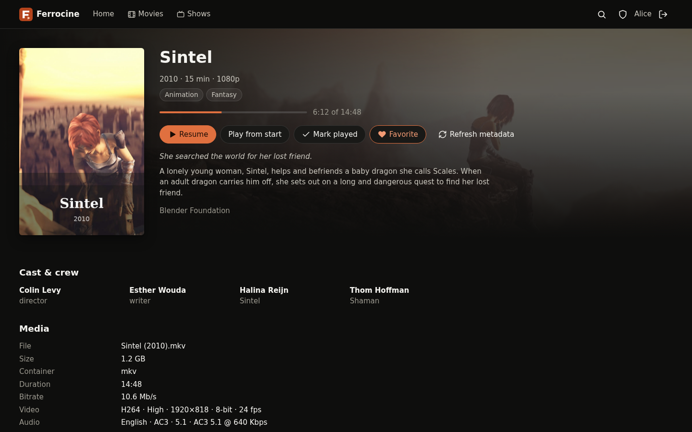
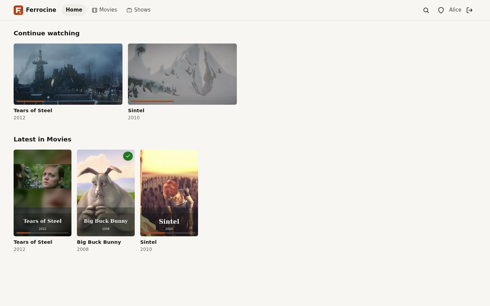

# Ferrocine UI

> [!NOTE]
> This project was created with [Anthropic Claude](https://www.anthropic.com/claude).

The web interface of [Ferrocine](https://github.com/sebastka/ferrocine), a self-hosted media server (an
alternative to Jellyfin and Emby) written in Rust: browse movie and series libraries, resume
where you stopped, and play anything in the browser, with direct play when the browser can,
and remuxing or (hardware-accelerated) transcoding by the core when it cannot.



<details>
<summary>Home page (light theme)</summary>



</details>

The screenshots show the core's development stack with the Blender Foundation's open movies
[Sintel](https://durian.blender.org/), [Big Buck Bunny](https://peach.blender.org/) and
[Tears of Steel](https://mango.blender.org/) (© Blender Foundation, CC BY 3.0); the posters are
frames from the films.

- **Home:** continue watching, next up, the latest additions of each library.
- **Libraries:** poster grids with sorting (title, date added, release date, year, rating), genre,
  played/unplayed and favorite filters, a title filter and infinite scrolling. Filters live in
  the URL.
- **Details:** backdrop, poster, title logo, ratings per source (TMDB, IMDb, Rotten Tomatoes,
  Metacritic, AniList, AniDB) and links to the metadata sites, overview, cast and crew, technical information of the file;
  seasons and episodes with progress; a movie's extras (trailers, featurettes…), played in one click; mark played, favorite; "Refresh metadata" for admins.
- **Player:** custom controls over the whole timeline, also when the core transcodes from the
  middle of a file; audio track, subtitles (text ones in the browser, bitmap ones such as PGS and DVD burned in by
  the core) and quality menus; chapters on the seek bar and in a menu; subtitle search and download
  (OpenSubtitles, through the core) when the server has a provider; keyboard shortcuts; position
  saved every 10 s; "Up next" at the end of an episode.
- **Search** across movies, series and episodes by title (original and translated ones too), cast
  and crew, words in any order; results found by a name say why ("with Keanu Reeves (Neo)").
- **Administration:** the running configuration (every setting with its value, default, description
  and alternatives; secrets only as set or not), configuration reload (with its report), ffmpeg and hardware acceleration in use,
  library scans (with or without a metadata refresh), active transcodes.
- **Account:** the user's picture from the identity provider (or their initials) in the header,
  with a menu to the profile page (name, e-mail, role, groups) and to log out.
- Light and dark themes: follows the system, or forced from the account menu or the profile page
  (remembered per browser). Usable from phone width up.

Sign-in, sessions and the API belong to the core (OpenID Connect, cookie session); the UI and the
API must share one origin. The [API contract](docs/api.md) is a copy of the core's
`docs/api.md`.

## Deployment

The image serves the built UI with nginx and proxies `/api/`, `/auth/`, `/healthz` and
`/readyz` to the core, so the browser sees one origin.

```yaml
services:
  ferrocine:
    image: ghcr.io/sebastka/ferrocine:edge
    # … see the core's deploy/ directory
  ui:
    image: ghcr.io/sebastka/ferrocine-ui:edge
    ports: ['8080:8080']
    environment:
      FERROCINE_UPSTREAM: http://ferrocine:8096
    read_only: true
    tmpfs: [/tmp]
    cap_drop: [ALL]
    security_opt: ['no-new-privileges:true']
```

Set the core's `server.public_url` to the URL users open (the UI's), since the OIDC redirect
goes there and the core checks `Origin` against it.

| Variable             | Default                            | Purpose                                    |
| -------------------- | ---------------------------------- | ------------------------------------------ |
| `FERROCINE_UPSTREAM` | `http://ferrocine:8096`            | The core: `http(s)://host[:port]`, no path |
| `NGINX_RESOLVER`     | name servers of `/etc/resolv.conf` | DNS servers nginx uses to find the core    |

- Listens on **8080** as user 65532; works with a read-only root filesystem when `/tmp` is
  writable (a tmpfs).
- `GET /ui-healthz` is the container's own liveness probe (the image's `HEALTHCHECK`);
  `/healthz` and `/readyz` are the core's.
- TLS belongs to the ingress or proxy in front; it should pass `X-Forwarded-Proto`.
- Headers: a strict Content Security Policy (`default-src 'self'`, no inline script or style,
  `frame-ancestors 'none'`), `nosniff`, `Referrer-Policy: same-origin`. Hashed assets are cached
  for a year, `index.html` is revalidated on every load.

## Development

Node 26 (`.nvmrc`). With a core on `127.0.0.1:8096` whose `server.public_url` is
`http://localhost:5173`:

```sh
npm install
npm run dev            # Vite on http://localhost:5173, /api/ and /auth/ proxied to the core
npm run check          # typecheck, lint, format check, unit tests
npm run build          # dist/
docker compose up -d --build   # the production image on :8080, in front of a core on the host
```

`FERROCINE_UPSTREAM` changes the core address of `npm run dev` too.

## Layout

| Path                       | Contents                                                                         |
| -------------------------- | -------------------------------------------------------------------------------- |
| `src/api.ts`               | API types (from `docs/api.md`) and calls                                         |
| `src/logic/`               | Pure logic, unit-tested: capability detection, seek planning, formatting, routes |
| `src/player/controller.ts` | Playback sessions, hls.js, seeking, subtitles, progress reports                  |
| `src/views/`               | Pages: home, library, item, search, admin, player, sign-in                       |
| `src/components/`          | Cards, header, icons, small UI pieces                                            |
| `deploy/nginx/`            | nginx configuration template and entrypoint of the image                         |
| `test/`                    | `node --test` unit tests                                                         |

## License

[MIT](LICENSE)
